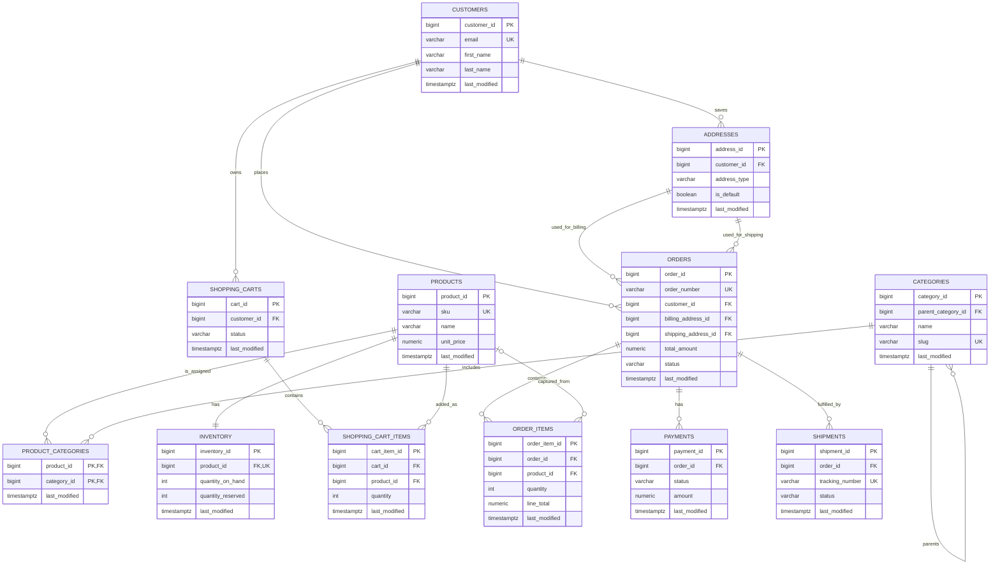

# Example E-Commerce OLTP System

This directory contains PostgreSQL DDL for an example e-commerce transactional system. Each table is defined in its own file under [`table_ddl`](table_ddl/).

Every table includes a `last_modified` column. It defaults to the row creation time and a shared trigger updates it automatically whenever that row is changed.

## Tables

| Table | Purpose |
| --- | --- |
| [`customers`](table_ddl/customers.sql) | Customer accounts and contact details. |
| [`addresses`](table_ddl/addresses.sql) | Customer shipping, billing, and other saved addresses. |
| [`categories`](table_ddl/categories.sql) | Hierarchical product catalog categories. |
| [`products`](table_ddl/products.sql) | Sellable product catalog entries and current base price. |
| [`product_categories`](table_ddl/product_categories.sql) | Many-to-many assignment of products to categories. |
| [`inventory`](table_ddl/inventory.sql) | Per-product on-hand, reserved, and reorder quantities. |
| [`shopping_carts`](table_ddl/shopping_carts.sql) | Customer shopping carts and their lifecycle status. |
| [`shopping_cart_items`](table_ddl/shopping_cart_items.sql) | Products and quantities in each shopping cart. |
| [`orders`](table_ddl/orders.sql) | Order headers, totals, lifecycle status, and selected addresses. |
| [`order_items`](table_ddl/order_items.sql) | Purchased-product line items, including price snapshots. |
| [`payments`](table_ddl/payments.sql) | Payment attempts and their provider transaction details. |
| [`shipments`](table_ddl/shipments.sql) | Fulfillment and delivery tracking records for orders. |

## Entity Relationship Diagram



## Suggested creation order

Run the DDL files in this dependency order:

1. `customers.sql`
2. `categories.sql`
3. `products.sql`
4. `addresses.sql`
5. `inventory.sql`
6. `product_categories.sql`
7. `shopping_carts.sql`
8. `shopping_cart_items.sql`
9. `orders.sql`
10. `order_items.sql`
11. `payments.sql`
12. `shipments.sql`

## Run locally with Docker

From the project root, start PostgreSQL and initialize the schema:

```sh
docker compose up -d
```

The database is available at `localhost:5432` with database `ecommerce`, user `ecommerce_app`, and password `ecommerce_app_password`. On its first start, Compose runs [`init-db.sh`](init-db.sh), which applies every DDL file in the creation order above. The database data is stored in the `postgres_data` Docker volume, so initialization does not run again while that volume exists.

To reset the local database and initialize it again:

```sh
docker compose down -v
docker compose up -d
```
